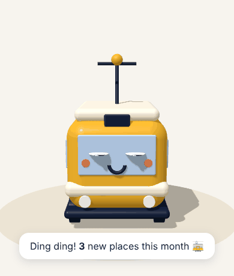
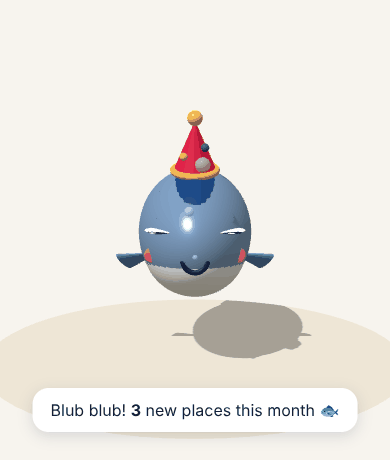
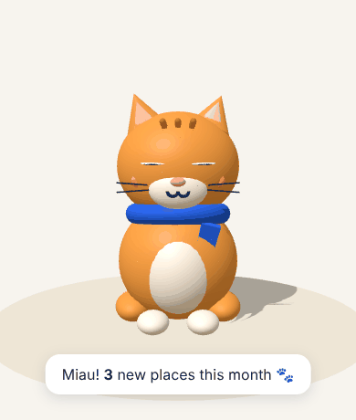
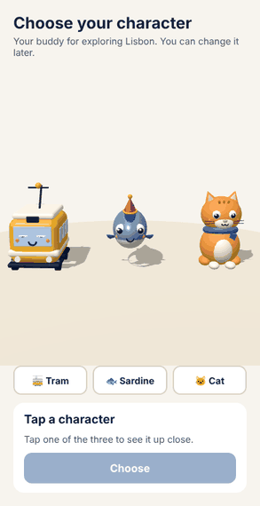

# Characters (prototype)

Players choose a buddy character that represents them in the app (issue #20).
These were the design prototypes. The picker is now in the app: a "Your buddy"
card on the Collection screen opens it (`src/components/BuddyCard.jsx`,
`CharacterPicker.jsx`, `BuddyAvatar.jsx`, models in `src/lib/characters3d.js`).

| Tram | Sardine | Cat |
| --- | --- | --- |
|  |  |  |
| "Ding ding!" | "Blub blub!" | "Miau!" |
| Lisbon's yellow trams | The June festival (Santo António) | The street cats of the old town |

## The character picker

Tap a character (or its button): it slides to the front, gets bigger and spins.
The other two step back and wait. "Choose" confirms the choice.

## Files

| File | What it is |
| --- | --- |
| `picker.html` | The "Choose your character" page with all three characters |
| `tram3d.html`, `sardine3d.html`, `cat3d.html` | Each character on its own |
| `*.gif` | Recordings, so you can see them on GitHub without running anything |

To try the pages live, run `npx vite design/characters` and open the address
it prints, for example `http://localhost:5173/picker.html`. They need internet,
because they load the 3D library from a CDN.

## How it works

The characters use [three.js](https://threejs.org), a free library for 3D in the browser.
Each one is built from simple shapes, like LEGO:

- **Tram:** rounded boxes (body, roof, stripes), cylinders (wheels, lights)
- **Sardine:** stretched spheres (body, belly, back), flat cones (tail, fins), a cone hat
- **Cat:** spheres (body, head, paws), cones (ears), a curved tube (tail), thin cylinders (whiskers)

All three share the same eyes (white sphere, navy pupil, white shine dot),
pink cheeks and lighting, so they look like one family.

In the picker:

- **Which character was tapped?** A line is "shot" from the finger into the
  3D scene and the first character it hits is selected (raycasting).
- **Smooth movement:** every frame each character moves a small step towards
  where it should be (front and big if selected, back and small if not).
- **Buttons** do the same as tapping, so it is easy to use and the touch areas
  are at least 44 px.

## Limits and open questions

- The choice is saved **in this browser only** (`getCharacter`/`setCharacter` in
  `api.js`). To share it with friends, Person 3 adds a column to profiles and
  changes only those two functions.
- three.js is a large dependency. Check that it runs smoothly on a phone.
- The texts (catchphrases, descriptions) are first drafts.
