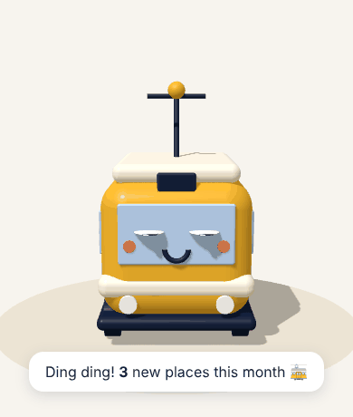

# Tram mascot (prototype)

Our app's mascot: a little yellow Lisbon tram that twirls, bounces and blinks.

This is a **design prototype**, not part of the app yet. It lives here so the
team can see it and decide how to use it (issue #12).

## Files

- `tram3d.html` - the live 3D tram. Open it with `npx vite design/tram-mascot`
  and go to the address it prints (it needs internet for the 3D library).
- `tram3d.gif` - a recording of the tram turning once, for quick viewing on GitHub.

## How it works

It uses [three.js](https://threejs.org), a free library for 3D in the browser.
The tram is built from simple 3D shapes:

| Part | Shape |
| --- | --- |
| Body, roof, stripes | Rounded boxes |
| Eyes | White spheres with smaller navy spheres in front and a white shine dot |
| Smile | Half a torus (a ring) |
| Wheels, headlights | Cylinders |
| Arm on the roof | A thin cylinder with a yellow sphere |

A light from the top left creates the shading and the shadow. Every frame the
tram turns a little, hops a little, and every 3.2 seconds the eyes are squashed
flat for a moment to blink.

## Open questions

- Name of the mascot
- Where it appears in the app (start: the "This month" card on the Collection screen)
- Moods (sleepy, happy, excited, worried on errors)
- three.js is a large dependency. Before adding it to the app we should check
  that it runs smoothly on a phone and explain why it is worth it.
