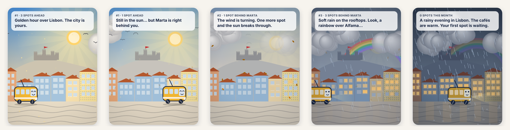

# Weather mood (prototype)

An animated Lisbon scene for the top of the Friends screen (issue #11).
The weather shows how you are doing in this month's leaderboard, so the
player *feels* the race instead of only reading a number.
The prototype here was built into the app: `src/lib/weatherScene.js` (drawing),
`src/components/WeatherScene.jsx` (on screen) and `weatherMood` in
`src/lib/friends.js` (which mood, with tests).

Video of all five moods: [weather.mp4](weather.mp4)

## The five moods

| Mood | When (draft rule) | What you see | Feeling |
| --- | --- | --- | --- |
| ☀️ Golden hour | You are #1, 2 or more spots ahead | Sun rays, seagulls, golden dust, the tram hops | Pride, warmth |
| 🌤️ Clouds coming | You are #1, 0–1 spots ahead (or a tie) | Clouds drift in, fewer birds | A little tension |
| ⛅ Windy | 1–2 spots behind first place | Wind, blowing leaves, the castle flag flutters | "Almost there!" |
| 🌦️ Soft rain | 3 or more spots behind | Rain, first windows light up, a rainbow | Melancholy but hopeful |
| 🌧️ Rainy evening | 0 spots this month | Warm glowing windows, tram headlight, wet street | Cosy, an invitation |

Rain is never a punishment: there is always a rainbow or a kind message.
Special cases still to decide: no friends yet, everyone at 0.

## Try it

Open `weather.html` in a browser (no internet or install needed). The five
buttons switch moods; in the app the mood will come from the leaderboard.

## How it works

- The scene is drawn live with the HTML canvas (about 60 times a second), in
  layers like a stage set: sky, sun, clouds, birds, castle hill, houses,
  street, tram, leaves, rain, and a colour filter on top.
- Each mood is a list of **dials** (sun, clouds, darkness, rain, wind, birds,
  ...). When the mood changes, every dial turns a little each frame towards
  its new value, so the weather melts into the next mood instead of jumping.
- Lisbon details: Castelo de São Jorge, pastel houses with terracotta roofs
  and azulejo patterns, and the black-and-white *calçada* waves.

## Limits and open questions

- The rule (which mood for which situation) should become a plain function in
  `src/lib/progress.js` with tests, like the other ranking logic.
- Animation uses battery: in the app it should pause when the screen is hidden.
- Ideas: ambient sound (with a mute button), real time of day, the player's
  chosen character (#20) instead of the tram.
- The texts are first drafts.
